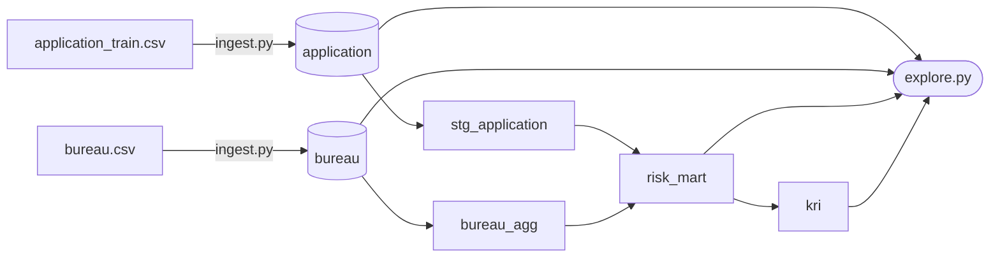
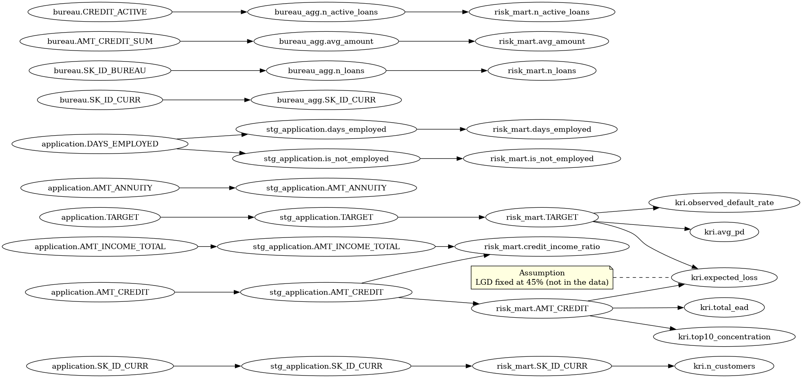

# CreditRisk

A small, reproducible credit-risk data pipeline on the
[Home Credit Default Risk](https://www.kaggle.com/competitions/home-credit-default-risk)
data: raw CSVs are loaded into DuckDB, transformed and tested with dbt,
explored with a few SQL questions, and documented with a validated
column-level lineage.

## How to run

Prerequisites:

- [uv](https://docs.astral.sh/uv/) (Python 3.12 is installed by uv)
- A Kaggle account that has accepted the competition rules, with credentials in
  `.env` at the project root:

  ```
  KAGGLE_USERNAME=...
  KAGGLE_KEY=...
  ```

Set up the environment, then run the steps in order (from the project root):

```bash
uv sync
```

`uv sync` installs the `dev` group (pytest, nbstripout) and the `notebook`
group (pandas, ipykernel, the kernel for the legacy exploration notebook).
Both are default groups in `pyproject.toml`, so later `uv` commands keep them.

Before committing notebook changes, run `uv run nbstripout --install` once per
clone. `.gitattributes` then strips notebook outputs on every commit, so no
raw Kaggle data reaches git, while your local notebook keeps its outputs.

```bash
uv run python ingest.py
```

```bash
cd risk_dbt && uv run dbt deps && uv run dbt build && cd ..
```

```bash
uv run python explore.py
```

```bash
uv run python lineage/lineage.py
```

| Step | What it does |
|---|---|
| `ingest.py` | Downloads the competition files with `kagglehub` and loads `application_train.csv` → `application` and `bureau.csv` → `bureau` into `risk.duckdb` (`CREATE OR REPLACE`, so it is safe to re-run). |
| `dbt deps` | Installs `dbt_utils` (pinned in `risk_dbt/package-lock.yml`). Needed once per checkout. |
| `dbt build` | Builds `stg_application`, `bureau_agg`, `risk_mart` and `kri` and runs every data test. Must be run from `risk_dbt/`, because `profiles.yml` points to `../risk.duckdb`. |
| `explore.py` | Prints the exploratory questions below. Opens the database read-only. |
| `lineage/lineage.py` | Checks the documented column-level lineage against the latest `dbt build` (exit code 1 on mismatch), then redraws `outputs/lineage.png` and `outputs/lineage.svg`. Reads `risk_dbt/target/manifest.json`, so run it after `dbt build`. |

`risk.duckdb` is fully generated: delete it and re-run the steps to rebuild
from scratch.

## Project structure

```
CreditRisk/
├── ingest.py                   # 1. Kaggle download -> raw tables in risk.duckdb
├── risk_dbt/                   # 2. All transformations and data tests
│   ├── dbt_project.yml
│   ├── profiles.yml            # DuckDB target: ../risk.duckdb
│   ├── packages.yml            # dbt_utils
│   ├── package-lock.yml
│   ├── models/
│   │   ├── sources.yml         # raw.application, raw.bureau
│   │   ├── stg_application.sql # application columns in use, DAYS_EMPLOYED cleaned
│   │   ├── bureau_agg.sql      # bureau loans aggregated per applicant
│   │   ├── risk_mart.sql       # one row per applicant, enriched with bureau history
│   │   ├── kri.sql             # portfolio key risk indicators (PD, EAD, EL, concentration)
│   │   └── schema.yml          # column docs + generic tests
│   └── tests/                  # singular tests
│       ├── assert_no_1000_years_employed.sql
│       ├── assert_pd_reconciles.sql
│       └── assert_row_count_matches.sql
├── explore.py                  # 3. Exploratory questions
├── lineage/lineage.py          # 4. Column-level lineage: check, trace/impact, draw
├── src/credit_risk/config.py   # Shared paths (project root, database file)
├── tests/
│   ├── sample_data.py          # Synthetic raw tables for tests and CI
│   └── test_lineage.py         # pytest suite for the lineage checks
├── .github/workflows/ci.yml    # pytest + dbt build + lineage check on sample data
├── legacy/                     # Original exploration notebook and Python DQ checks
├── outputs/                    # lineage.png, lineage.svg (generated by lineage.py)
├── pyproject.toml, uv.lock     # Python dependencies
├── LICENSE                     # MIT, code only (data is not included)
└── .env                        # Kaggle credentials (never committed)
```

## Lineage

Lineage is documented at two levels:

| Level | Tool | Source of truth |
|---|---|---|
| Table | dbt docs | Derived automatically from `source()` and `ref()` in the models |
| Column | `lineage/lineage.py` | The hand-written `LINEAGE` list, a golden baseline validated against the dbt build |

### Table level: dbt docs

dbt builds its DAG from `source()` and `ref()`, so the lineage graph in dbt
docs always matches the models. It stops at tables, though: it shows that
`risk_mart` depends on `stg_application` and `bureau_agg`, but not which
column feeds which.

```bash
cd risk_dbt && uv run dbt docs generate && uv run dbt docs serve
```

Overview of the whole pipeline, including the Python steps that dbt does not
see:



### Column level: lineage/

`LINEAGE` in `lineage/lineage.py` lists every one-hop `(source, target,
transformation)` edge, written by hand from the model SQL. Because it is
manual, every run validates it against the latest `dbt build` before drawing.
`check_consistency()` fails with exit code 1, and leaves the diagrams
untouched, if any of these checks fail:

1. **Models.** The model list comes from `risk_dbt/target/manifest.json`,
   not from a hard-coded list. A new model such as `stg_application` cannot be
   skipped: every model must be built, and its columns in `risk.duckdb` must
   match the documented columns exactly. Every documented source column must
   exist in the raw tables, and every table in `LINEAGE` must be a dbt model or
   source.
2. **Edges.** [sqlglot](https://github.com/tobymao/sqlglot) parses each model's
   compiled SQL from the manifest and derives which input columns feed each
   output column. These edges must match the documented ones. This catches
   what column names alone cannot: an edge that still points to
   `application` after `risk_mart` was moved onto `stg_application`, or
   a ratio documented with the wrong input column.

`trace(column)` returns every edge upstream of a column, and `impact(column)`
returns every edge downstream of it. `draw_lineage()` renders
`outputs/lineage.png` and `outputs/lineage.svg`. Hover over an edge in the
SVG to see its transformation.

Notes:

- Identifiers are compared case-insensitively, like DuckDB, because sqlglot
  lowercases unquoted names.
- A `COUNT(*)` has no input column for sqlglot to find. Such columns are listed
  in `ROW_COUNT_COLUMNS` (`bureau_agg.n_loans`, `kri.n_customers`), and their
  documented edge is accepted while the SQL still counts rows.
- A fixed assumption in the SQL has no input column either. Such columns are
  listed in `ASSUMPTION_COLUMNS` (`kri.expected_loss`, which uses LGD = 0.45).
- The checks verify which columns are connected, not the transformation text.
  Review that against the SQL by hand.

When a model changes, update `LINEAGE` in the same change and rerun
`dbt build` before the check, so the manifest holds the new compiled SQL.



## Data tests

All data quality checks live in dbt and run with `dbt build`.

| Test | Where | Checks |
|---|---|---|
| `unique`, `not_null` on `stg_application.SK_ID_CURR` and `risk_mart.SK_ID_CURR` | `schema.yml` | One row per applicant |
| `not_null`, `dbt_utils.expression_is_true "> 0"` on `stg_application.AMT_INCOME_TOTAL` | `schema.yml` | Positive income |
| `not_null`, `accepted_values [0, 1]` on `risk_mart.TARGET` | `schema.yml` | Valid label |
| `not_null` on `risk_mart.n_loans`, `n_active_loans`, `is_not_employed`, `credit_income_ratio` | `schema.yml` | Missing bureau data is filled, ratio is always defined |
| `assert_no_1000_years_employed` | `risk_dbt/tests/` | The `365243` placeholder never reaches `risk_mart.days_employed` |
| `assert_row_count_matches` | `risk_dbt/tests/` | The `LEFT JOIN` neither adds nor drops applicants |
| `not_null` on every `kri` column; `accepted_range [0, 1]` on `observed_default_rate`, `top10_concentration`; `> 0` / `>= 0` on `n_customers`, `total_ead`, `expected_loss`; `expected_loss <= total_ead` | `schema.yml` | KRIs are defined and in a plausible range |
| `assert_pd_reconciles` | `risk_dbt/tests/` | The segment PDs, weighted by customers, add back up to the observed default rate |

## Testing and CI

```bash
uv run pytest
```

The pytest suite in `tests/` builds every dbt model from its real SQL on a
small synthetic database (`tests/sample_data.py`) and checks that
`check_consistency()` passes. It then breaks `LINEAGE`, the model SQL or
`ROW_COUNT_COLUMNS` in specific ways (a stale edge, a wrong input column, an
undocumented model, ...) and checks that each one is reported.

GitHub Actions (`.github/workflows/ci.yml`) runs on every push to `main` and
on pull requests. The Kaggle data cannot be downloaded or redistributed in
CI, so CI uses the synthetic sample data instead of `ingest.py`, then runs
pytest, `dbt build`, the lineage check and `explore.py`. The lineage check
runs with `--check-only`, which skips drawing the diagrams, so CI does not
need the Graphviz system package.

## Key findings

From `explore.py`:

1. **Strong class imbalance.** 282,686 applicants (91.9%) repaid and 24,825
   (8.1%) had payment difficulties, roughly 11 : 1. Accuracy is a misleading
   metric here; use AUC/PR-AUC and stratified splits.
2. **`DAYS_EMPLOYED = 365243` is a placeholder, not ~1,000 years of work.** It
   is the maximum value of the column and appears for 55,374 applicants (18.0%):
   55,352 pensioners and 22 unemployed. `stg_application` sets
   `days_employed` to NULL for them and flags them with `is_not_employed = 1`,
   and `risk_mart` passes both columns through.
3. **85.7% of applicants have a credit bureau history** (263,491 of 307,511).
   The other 44,020 get `n_loans = 0` and `n_active_loans = 0`, so 0 means
   either "no active loans" or "no bureau information".
4. **Default rate rises with the number of active loans.** It is lowest at one
   active loan and increases steadily from there:

   | n_active_loans | customers | default rate |
   |---:|---:|---:|
   | 0 | 90,361 | 7.8% |
   | 1 | 74,103 | 7.1% |
   | 2 | 58,383 | 7.4% |
   | 3 | 38,011 | 8.3% |
   | 4 | 22,041 | 9.2% |
   | 5 | 12,051 | 10.7% |
   | 6 | 6,107 | 11.7% |
   | 7 | 3,156 | 13.6% |

   The 0 group mixes two different populations: applicants with only closed
   loans (46,341, 5.7% default) and applicants with no bureau history at all
   (44,020, 10.1% default).
5. **The external scores are often missing.** `EXT_SOURCE_1` is missing for
   56.4% of applicants and `EXT_SOURCE_3` for 19.8%, while `EXT_SOURCE_2` is
   almost complete (0.2% missing). Any model using them needs an explicit
   missing-value strategy.
6. **Bureau amounts mix currencies.** 99.9% of bureau loans (98.8% of the
   amount) are in `currency 1`, and the other three currencies hold about 1.2%
   of the amount. `bureau_agg.avg_amount` averages across currencies without
   conversion; the effect is small but real.
7. **Portfolio KRIs** (`kri`, LGD fixed at 45% as an assumption):

   | KRI | Value |
   |---|---:|
   | Observed default rate | 8.07% |
   | Total EAD (sum of `AMT_CREDIT`) | 184.2 billion |
   | Expected loss | 6.71 billion (3.6% of EAD) |
   | EAD held by the largest 10% of loans | 24.4% |

   PD is the observed default rate per `n_active_loans` segment, estimated
   in-sample, so its customer-weighted average equals the observed default
   rate by construction. `assert_pd_reconciles` uses exactly that identity to
   check the PD calculation.

Income is complete and positive in the raw data (minimum 25,650, no NULLs), so
`credit_income_ratio` is always defined.

## Design decisions

- **DuckDB as a single-file warehouse.** No server to run; the whole
  pipeline rebuilds on a laptop in seconds, and `risk.duckdb` is a disposable
  build artifact.
- **dbt owns every transformation and data test.** Python only ingests,
  explores and checks lineage. The original Python data quality checks were
  replaced by dbt tests (kept in `legacy/` for reference).
- **A staging layer.** `stg_application` selects the raw columns in use and
  cleans the `DAYS_EMPLOYED` placeholder once, so `risk_mart` only joins and
  derives features.
- **Column lineage is written by hand, then verified by machine.** Lineage
  generated from the SQL would faithfully copy any mistake in the SQL. A
  hand-written `LINEAGE` states the intended data flow, and sqlglot proves
  that the SQL dbt actually compiled still matches it.
- **Pinned and reproducible.** `uv.lock` pins the Python environment,
  `package-lock.yml` pins dbt packages, and ingestion uses
  `CREATE OR REPLACE`, so every step can be re-run safely.

## Data and license

The code is released under the [MIT License](LICENSE). The Home Credit data is
**not** included in this repository: download it through Kaggle with
`ingest.py` after accepting the
[competition rules](https://www.kaggle.com/competitions/home-credit-default-risk/rules),
which govern how the data may be used.
